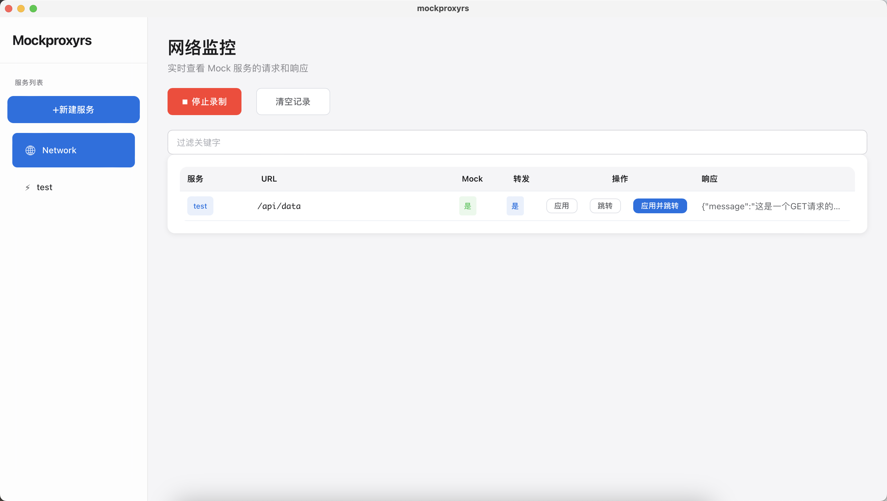
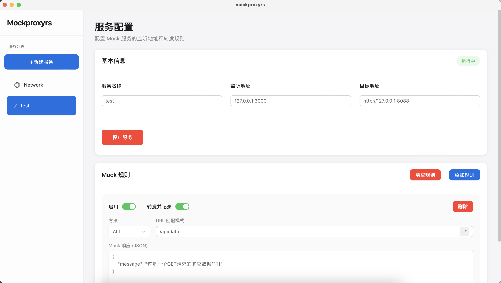

# Mockproxyrs

一个轻量级的反向代理和 Mock 服务工具，帮助开发者快速搭建 API 模拟环境。

## 项目简介

Mockproxyrs 是一个跨平台的代理与 Mock 工具，采用模块化架构设计，目前仅支持桌面应用。核心功能使用 Rust 编写，确保高性能和内存安全。

### 应用截图






### 主要特性

- **反向代理** - 将请求转发到目标服务器
- **Mock 服务** - 根据规则返回自定义响应，无需真实后端
- **响应集** - 一条规则保存多条命名响应，一键切换当前生效的响应
- **规则匹配** - 支持路径、方法、多维度匹配
- **MCP 接入** - 内置 MCP 服务器，AI 客户端可直接对规则增删改查，变更即时生效
- **事件驱动** - 实时查看请求/响应事件流
- **数据持久化** - 使用 SQLite 存储 Mock 规则和配置

## 项目结构

```
mockproxyrs/
├── core/           # 核心库 (Rust)
│   ├── domain/     # 领域模型 (Mock规则、代理配置)
│   ├── proxy/      # 代理服务器以及mock实现
│   ├── mcp/        # MCP 服务器（协议、工具、HTTP 传输）
│   ├── event/      # 事件系统
│   └── repository/ # 数据存储层
├── desktop/        # 桌面应用 (Tauri 2)
├── mcp-bridge/     # MCP stdio 桥接程序 (mockproxyrs-mcp)
├── server/         # 独立服务器 (计划中)
├── web/            # Web 前端 (Vue 3)
└── package.json    # 根目录开发入口 (npm 脚本转发，无依赖)
```

## 技术栈

### 后端/核心
- **Rust** - 系统编程语言
- **Tokio** - 异步运行时
- **Hyper** - HTTP 服务器/客户端
- **SQLite** - 数据持久化

### 桌面应用
- **Tauri 2** - 跨平台桌面框架
- **Rust** - 原生后端

### Web 前端
- **Vue 3** - 渐进式 JavaScript 框架
- **TypeScript** - 类型安全
- **Element Plus** - UI 组件库
- **Pinia** - 状态管理
- **Vite** - 构建工具

## 快速开始

### 安装后运行环境
- Windows 10+ /macOS 10.15+ / 主流 Linux 发行版
- Windows 需预装或自动安装 WebView2 Runtime
- 无需额外数据库、运行时环境

### 环境要求

- Rust 1.70+
- Node.js 18+
- npm 或 pnpm

### 安装依赖

```bash
# 安装 Web 前端依赖
cd web && npm install

# 安装桌面应用依赖
cd desktop && npm install
```

> 根目录的 `package.json` 只是开发入口（把 `npm run dev` / `npm run build` 转发到 `desktop/`），本身没有依赖，**不需要**在根目录执行 `npm install`。

### 开发模式

在根目录执行：

```bash
# 启动桌面应用 (开发模式)
npm run dev
```

这将同时启动：
- Vite 开发服务器 (http://localhost:1420)
- Tauri 桌面窗口

### 构建

```bash
# 构建桌面应用
npm run build
```

构建产物位于 `desktop/src-tauri/target/release/bundle/` 目录。

以上命令等价于 `cd desktop && npm run tauri dev` / `cd desktop && npm run tauri build`（旧用法仍然有效）。前端由 Tauri 的 `beforeDevCommand` / `beforeBuildCommand` 自动启动和构建，无需单独执行。

## 核心模块说明

### core - 核心库

平台无关的核心功能实现，采用领域驱动设计：

**domain - 领域模型**
- `MockService` - Mock 服务配置，定义监听地址和目标地址
- `MockServiceDetail` - 服务详情，包含运行状态
- `MockRule` - Mock 规则，支持 URL 模式、正则匹配、启用/禁用、转发记录等
- `ServiceStatus` - 服务运行状态
- `ResponseEvent` - 响应事件，用于推送到前端展示

**proxy - 代理服务器**
- `ProxyServer` - HTTP 代理服务器，处理请求转发和 Mock 响应
- `RuleMatcher` - 规则匹配器，根据 URL 匹配 Mock 规则
- `RuleStore` - 规则与服务的统一存取入口：写仓库并同步到运行中的服务，IPC 命令与 MCP 共用
- `UpstreamClient` - 上游客户端，负责转发请求到目标服务器，支持http、https

**mcp - MCP 服务器**
- `McpTools` - 工具定义与执行（服务/规则/响应集的查询与增删改）
- `McpHttpServer` - Streamable HTTP 传输，随桌面应用运行在本机回环地址
- `handle_message` - JSON-RPC 消息分发，传输无关

**event - 事件系统**
- `EventEmitter` - 事件发射器 trait，由不同平台实现
- `NoopEmitter` - 空实现，用于测试或不需要事件推送的场景

**repository - 数据存储**
- `MockRepository` - 数据仓库 trait，定义服务与规则的 CRUD 接口
- `SqliteRepository` - SQLite 实现，支持数据持久化

### desktop - 桌面应用

基于 Tauri 2 的跨平台桌面应用：

- 支持 macOS、Windows、Linux
- 原生系统集成

### web - Web 前端

Vue 3 单页应用：

- 响应式界面设计
- Mock 规则可视化管理
- 实时请求监控，支持一键新增、更新规则

## 功能配置说明

### 代理配置

代理服务支持以下配置项：

服务名称：用于区分
监听地址：代理服务的监听地址
目标地址：代理服务器监听后转发的目标地址


### Mock 规则
启用：是否启用规则，启用状态将返回mock响应，未启用直接请求目标地址并返回
转发并记录：启用状态下，开关打开将请求目标地址并记录真实响应然后返回mock响应
方法：请求方法get、post等
url匹配模式：路径，可含参数如：/api/data；开启正则模式则填写正则表达式
mock响应：启用状态将返回mock响应

#### 响应集与响应类型

一条规则可以保存多条命名响应（响应变体），在 Mock 响应编辑器上方以 tab 展示：
- 点击 tab 切换当前生效的响应，同一时间只有一条生效；再点一次已激活的 tab 则取消激活，回到规则本身的默认响应
- tab 条尾部的 `+` 新增一条响应（以当前内容为起点）并自动激活
- 右键 tab 可重命名或删除；删除激活项后回到规则本身的默认响应
- 没有任何响应变体时，使用规则本身的默认响应

每条响应（默认响应或变体）都有自己的类型，在编辑器右上角切换：
- **JSON**：静态响应体，原样返回
- **JS 脚本**：函数体，通过 `return { status, headers, body }` 按请求动态生成响应；编辑器提供语法校验与格式化，tab 上以 `JS` 标记脚本变体

每条响应只有一个内容槽：切换类型会清空当前内容（内容非空时先弹确认）。因此「成功 JSON / 失败 JSON / 按参数动态生成」可以作为同一条规则的三个变体并存，用 tab 切换。

变体独立于规则自身字段保存：编辑 URL、开关等不会动到响应集，通过 MCP 或其它页面改的变体也会实时同步到当前页面（正在编辑、尚未保存的规则除外）。

Mock 规则的 URL 匹配语义（按优先级，命中即停）：
1. 非正则：请求 **path**（`?` 之前）与 urlPattern **完全相等**（不是前缀匹配，`/api/users` 不会命中 `/api/users/123`）；同一 urlPattern 下精确方法优先于 ALL
2. 非正则：含 query 的**完整 URL** 与 urlPattern 完全相等（如 `/api/users?id=1`）；精确方法优先于 ALL
3. 正则：对 path 做**部分匹配**（不锚定首尾，`/api/users` 会命中 `/api/users/123` 和 `/api/users-admin`，要全路径匹配请写 `^...$`）；多条正则同时命中时取哪条**不确定**，请让正则互不重叠

注意：`enabled=false` 的规则**仍参与匹配**并会遮住后面的规则，只是命中后按透传处理。同一 urlPattern + method 的两条精确规则，后保存的覆盖先保存的。

### 网络监控
录制功能将记录经过代理服务的真实响应以及mock响应。
1. 若有真实响应，应用按钮可以新增规则、更新规则，将规则mock响应设置为本次真实响应
2. 若有匹配中规则可以直接跳转到规则页

### MCP（AI 接入）

桌面应用内置 MCP（Model Context Protocol）服务器，AI 客户端接入后可直接查询服务、对规则和响应集增删改查；
变更与界面上操作完全等价，对运行中的代理服务即时生效。

在侧边栏底部点击「MCP」打开配置面板：设置端口（默认 27120）、启动/停止服务器、设置是否随应用自动启动，并复制客户端配置：

- **HTTP（推荐）**：适用于支持 Streamable HTTP 传输的客户端（如 Claude Code、Cursor），直连 `http://127.0.0.1:27120/mcp`
- **stdio（桥接）**：适用于只支持子进程方式拉起服务器的客户端。先构建桥接程序 `cargo build -p mockproxyrs-mcp`，
  客户端配置中的 `command` 指向产物路径 `target/debug/mockproxyrs-mcp`，它会将 stdio 的 JSON-RPC 转发到桌面应用的 HTTP 端点

两种方式都要求桌面应用处于运行状态且已启动 MCP 服务器；服务器仅监听本机回环地址。

可用工具：`list_services`、`list_rules`、`get_rule`、`create_rule`、`update_rule`、`set_rule_enabled`、`delete_rule`、
`list_response_variants`、`add_response_variant`、`select_response_variant`、`delete_response_variant`。

## 开发指南

### 代码规范

- Rust 代码遵循 `cargo fmt` 格式化标准
- TypeScript/Vue 代码使用项目配置的 ESLint 规则

## 许可证

[Apache License 2.0](LICENSE)

## 贡献

欢迎提交 Issue 和 Pull Request！

## 作者

mazao
